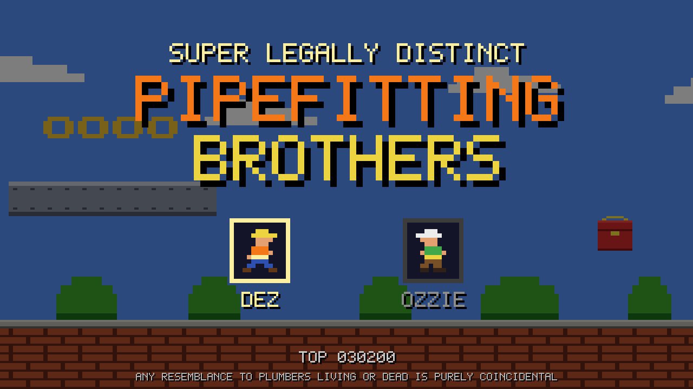

# Super Legally Distinct Pipefitting Brothers



Play now in your desktop browser! <https://jay.mcgavren.com/super-legally-distinct-pipefitting-bros/>

Definitely not a clone of a more popular 8-bit platformer. Pick your favorite
Pipefitting Brother, Dez or Ozzie, and run and jump your way to the main shutoff
valve before your shift runs out. Along the way, collect brass nuts and smash
crates. But watch out for the baddies!

*Any resemblance to plumbers living or dead is purely coincidental.*

It's a [wasmcart](https://wasmcart.org) cart written in Ruby on the
[wasmcart-mruby](https://github.com/wasmcart/wasmcart-mruby) runtime.

## Controls

| Action                 | Gamepad | Keyboard   |
|------------------------|---------|------------|
| Move                   | D-pad   | Arrow keys |
| Jump (hold to go higher) | A     | Space or X |
| Run / throw wrench     | B       | Z          |
| Pause                  | Start   | Enter      |

## Running

You need Node 22 or later. `main.wasm` (the runtime) is already in the repo, so
nothing else needs to be fetched.

```sh
npm install          # installs the wasmcart CLI
./run.sh             # play from source in dev mode
./pack.sh            # build pipefitting-bros.wasc
npx wasmcart pipefitting-bros.wasc   # play the packed cart
```

The high score is saved to `pipefitting-bros.wasc.sav` next to the cart.

## Layout

```
app/main.rb        the game
app/levels.rb      level maps (ASCII; the legend is at the top of the file)
app/sprites/       generated PNGs
app/sounds/        generated WAVs
main.wasm          prebuilt wasmcart-mruby runtime (vendored)
web/index.html     the web player page (GitHub Pages)
tools/             asset generator, test harness, web build
```

## Tools

The Ruby tools run the game under host Ruby with a stubbed `args`, so you can
test gameplay without opening a window.

- `node tools/make-assets.mjs` regenerates every sprite and sound in `app/`.
  The art is drawn at 2600 resolution, and the sounds are synthesized in the
  style of the 2600's TIA chip. Rerun it after editing.
- `ruby tools/sim.rb` runs the scripted scenarios in `tools/scenarios/` and
  reports PASS or FAIL for each.
- `ruby tools/reach.rb [level...]` uses the real player physics to check that
  each level's goal can be reached, and lists the platforms the player can't
  reach.
- `ruby tools/bot.rb` sends a simple bot through each level and reports where
  it gets stuck or dies.
- `tools/build-web.sh` packs the cart and builds the web player in
  `build/web/`. Serve that folder to try it, e.g.
  `python3 -m http.server -d build/web`.
- `tools/publish-web.sh "message"` commits `build/web/` as the next commit on
  the `gh-pages` branch without checking it out. That branch holds only the
  built web player; all source lives on `main`.
- `tools/mockup.rb` is the static scene used to plan the look. It isn't part
  of the game.

## License

MIT. See [LICENSE.txt](LICENSE.txt), which also includes the license for the
bundled wasmcart-mruby runtime.
